# Final DevOps Project - TripBoard

**TripBoard** is a small trip planner (plan trips, track budgets, move them from *planned → booked → done*). The app itself is simple on purpose. The point of the project is everything around it: containers, CI/CD with security gates, Kubernetes + Helm, infrastructure as code, monitoring and GitOps, plus a troubleshooting challenge on the running system.

Snehangshu Roy

```
final-devops-project/
├── application/
│   ├── backend/            FastAPI + SQLAlchemy + Alembic, /metrics, 9 pytest tests
│   └── frontend/           React (Vite)
├── docker/                 backend + frontend Dockerfiles (multi-stage, non-root), nginx template, docker-compose.yml
├── kubernetes/             namespace with Pod Security "restricted"
├── helm/tripboard/         Helm chart: backend, frontend, postgres StatefulSet, ingress, HPA, probes, NetworkPolicy, ServiceMonitor, helm test
├── terraform/              kind cluster + cluster add-ons (Helm) + app bootstrap + AWS VPC/S3 (+ EKS for real AWS)
├── .github/workflows/      -> pipeline lives in the repo root: ../.github/workflows/final-project.yml
├── security/               bandit + gitleaks configs
├── monitoring/             kube-prometheus-stack values, Grafana dashboard, alert rules
├── gitops/                 Argo CD values, Argo CD Application, values-prod.yaml (updated by CI)
├── troubleshooting/        final troubleshooting challenge write-up
└── screenshots/
```

---

## Architecture

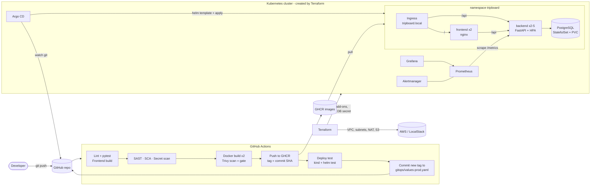

Request path: browser → ingress-nginx → `/` frontend (static React) or `/api` backend → PostgreSQL.

Delivery path: commit → pipeline (test, scan, build, scan, push) → pipeline commits the new image tag to git → Argo CD notices → rolling update.

## Technologies

| Area | Tools |
|---|---|
| Application | Python 3.12, FastAPI, SQLAlchemy 2, Alembic, PostgreSQL 16, React 19 + Vite |
| Testing | pytest + coverage (SQLite in-memory test DB), flake8 |
| Containers | Docker multi-stage builds, docker compose, nginx-unprivileged |
| CI/CD | GitHub Actions, GitHub Container Registry |
| DevSecOps | Bandit + Semgrep (SAST), pip-audit + npm audit (SCA), Gitleaks (secrets), Trivy (images), Pod Security "restricted", NetworkPolicy, non-root containers |
| Kubernetes | kind (v1.33), ingress-nginx, metrics-server, HPA, probes, StatefulSet + PVC |
| Packaging | Helm 3 |
| IaC | Terraform (kind, helm, kubernetes, aws, random providers), LocalStack |
| Monitoring | kube-prometheus-stack (Prometheus, Alertmanager, Grafana), prometheus-fastapi-instrumentator |
| GitOps | Argo CD 3.5 (multi-source Application, auto-sync, prune, self-heal) |

---

## 1. Application

Backend endpoints:

| Method | Path | |
|---|---|---|
| GET | `/health` | liveness |
| GET | `/ready` | readiness (checks the DB) |
| GET | `/api/info` | app name, version (git SHA), environment |
| GET/POST | `/api/trips` | list / create |
| GET/PUT/DELETE | `/api/trips/{id}` | read / update / delete |
| GET | `/metrics` | Prometheus metrics (`http_requests_total`, `http_request_duration_seconds`, `tripboard_trips{status}`) |

- Schema is managed with **Alembic** ([0001_create_trips.py](application/backend/alembic/versions/0001_create_trips.py)). Migrations run at container start, and a Postgres **advisory lock** in `alembic/env.py` stops several backend pods from migrating at the same time.
- The entrypoint **waits for the database** before migrating, because on first deploy Postgres and the backend start together.
- Tests use an in-memory SQLite DB through a FastAPI dependency override, never the real database.

## 2. Docker

```bash
docker compose -f docker/docker-compose.yml up --build -d
# frontend http://localhost:3000, backend http://localhost:8000
```

- [backend.Dockerfile](docker/backend.Dockerfile): python:3.12-alpine, deps in a venv in a build stage, `apk upgrade`, runs as uid **10001**.
- [frontend.Dockerfile](docker/frontend.Dockerfile): Node 22 build stage → `nginx-unprivileged` (uid **101**, port 8080). [nginx.conf.template](docker/nginx.conf.template) proxies `/api` to the backend, resolving the name per request (so nginx starts even if the backend isn't there yet).

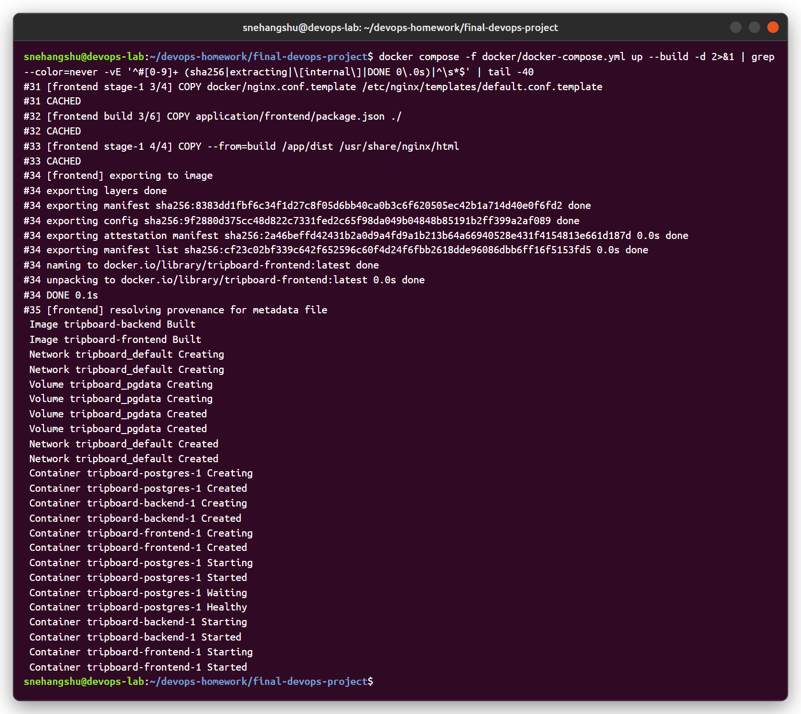
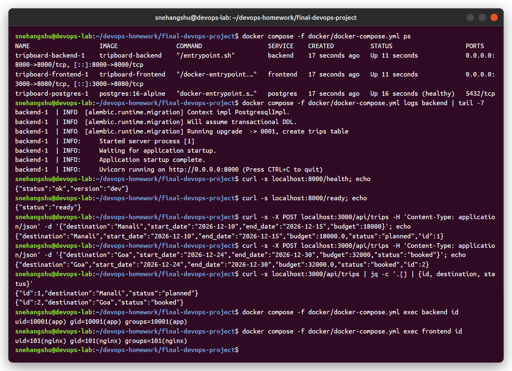
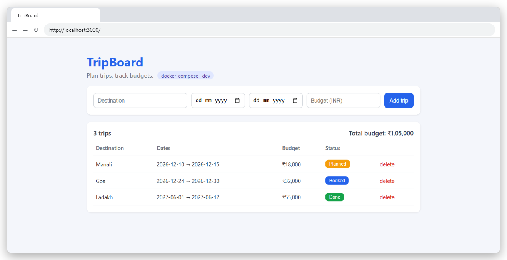

## 3. Terraform infrastructure

[terraform/](terraform) provisions everything except the app itself:

| File | Creates |
|---|---|
| [cluster.tf](terraform/cluster.tf) | kind cluster: 1 control plane (ports 80/443 mapped for ingress) + 2 workers |
| [addons.tf](terraform/addons.tf) | Helm releases: ingress-nginx, metrics-server, kube-prometheus-stack, Argo CD |
| [app-bootstrap.tf](terraform/app-bootstrap.tf) | namespace `tripboard` (Pod Security restricted) + `tripboard-db` secret with a **random password** (never in git) |
| [aws-network.tf](terraform/aws-network.tf) | VPC 10.30.0.0/16, **2 public + 2 private subnets** in 2 AZs, IGW, NAT gateway, route tables, S3 backup bucket (versioning, encryption, lifecycle, no public access) |
| [eks.tf](terraform/eks.tf) | EKS cluster + managed node group + IAM roles, behind `create_eks` (real AWS only) |

> **Honest note:** I don't have an AWS account, so the AWS provider points to **LocalStack** (AWS emulator) and the Kubernetes cluster is **kind** instead of EKS. LocalStack community edition has no EKS API, so `eks.tf` is written for real AWS (`use_localstack=false, create_eks=true`) but was not applied. [terraform.tfvars.example](terraform/terraform.tfvars.example) is committed, but no credentials.

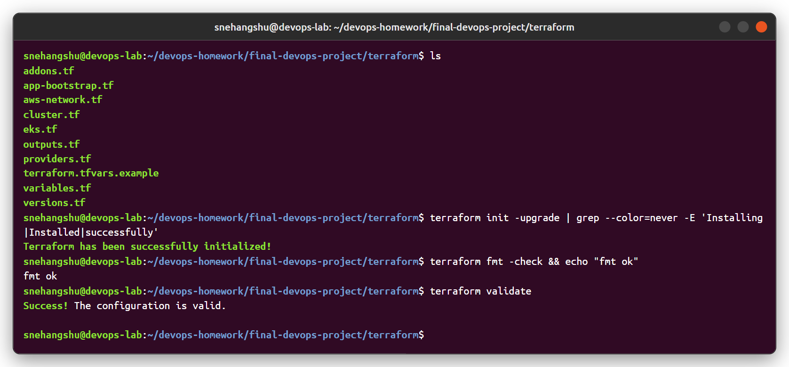
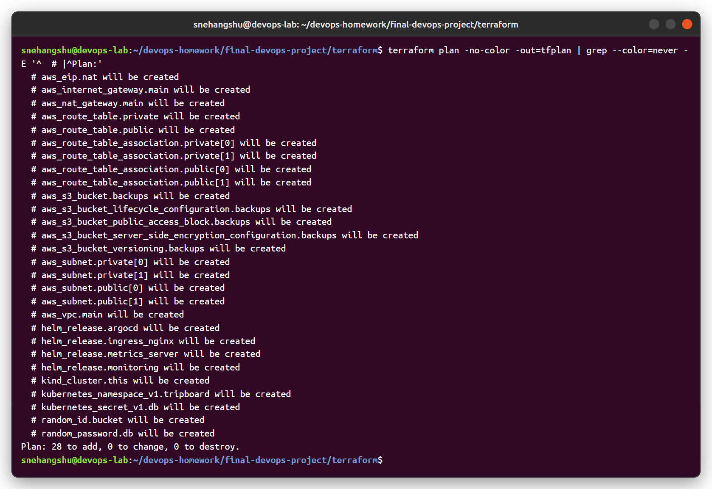
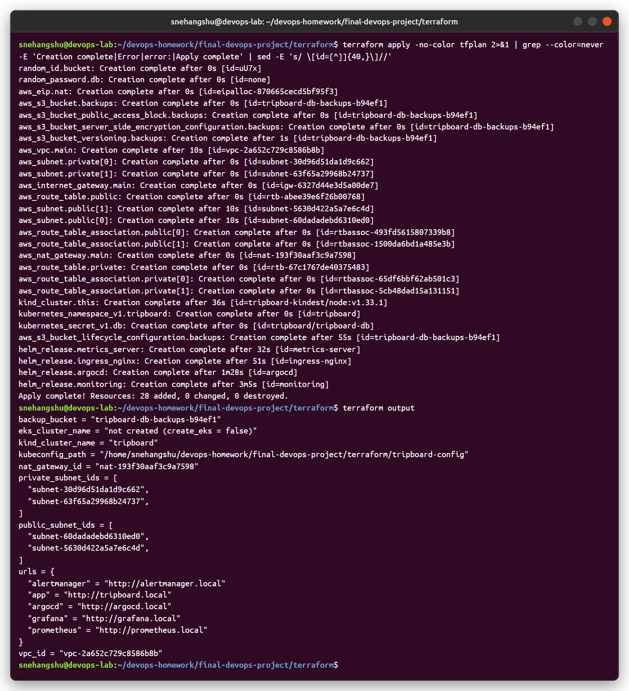
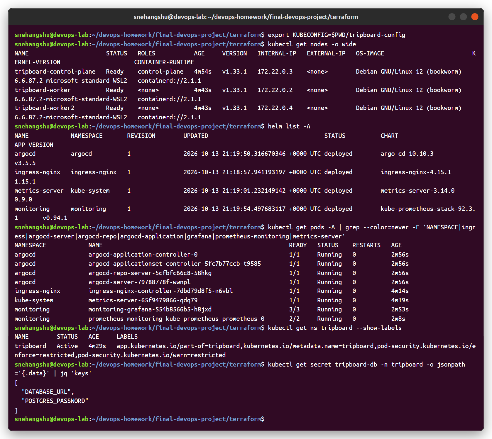
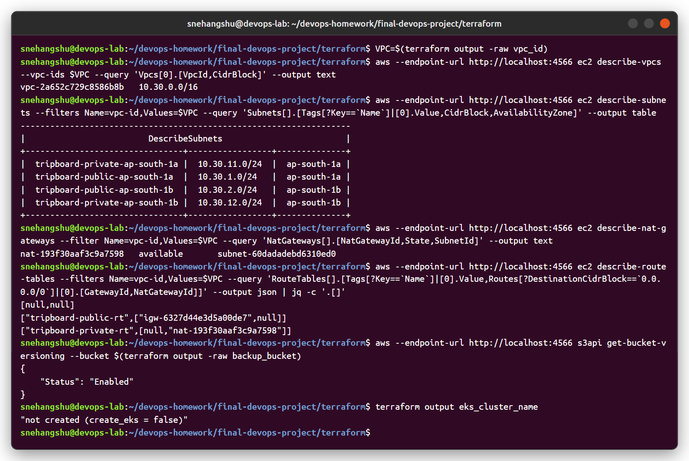

`terraform destroy` at the end removed all 28 resources:

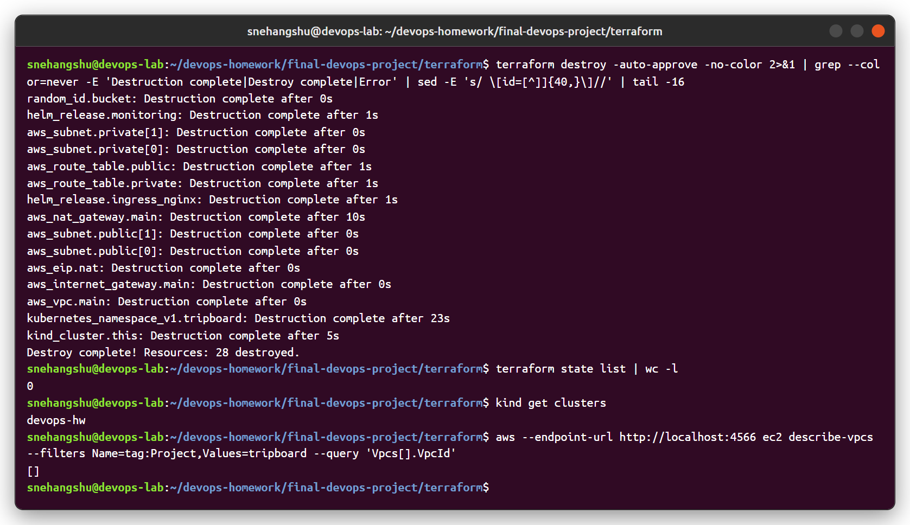

## 4. CI/CD pipeline

[`.github/workflows/final-project.yml`](../.github/workflows/final-project.yml), runs on every push to `main` that touches the project (GitOps commits and docs are excluded so the bot commit doesn't loop).

| # | Job | Fails the pipeline when |
|---|---|---|
| 1 | Backend - lint & test | flake8 error or any pytest failure |
| 2 | Frontend - build | `npm run build` fails |
| 3 | SAST - Bandit + Semgrep | Bandit medium+ or any Semgrep finding (python, react, dockerfile rules) |
| 4 | SCA - pip-audit + npm audit | known CVE in a backend dependency / high+ in frontend |
| 5 | Secret scan - Gitleaks | a secret in the project files |
| 6 | Docker build (backend, frontend) + **Trivy** | fixable HIGH/CRITICAL CVE in the image (this is the **security gate**) |
| 7 | Push to GHCR | - images tagged with the **commit SHA** only, never `latest` |
| 8 | Deploy test | `helm upgrade --install --wait` on a throw-away kind cluster + `helm test` + API smoke test fail |
| 9 | Update GitOps manifest | - commits `deploy: tripboard <sha>` to `gitops/values-prod.yaml` |

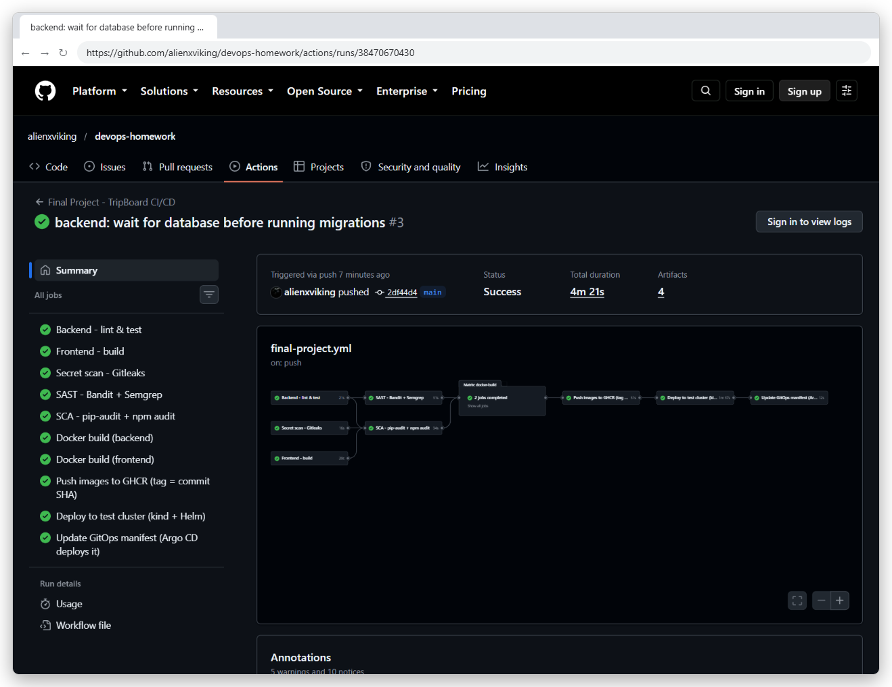
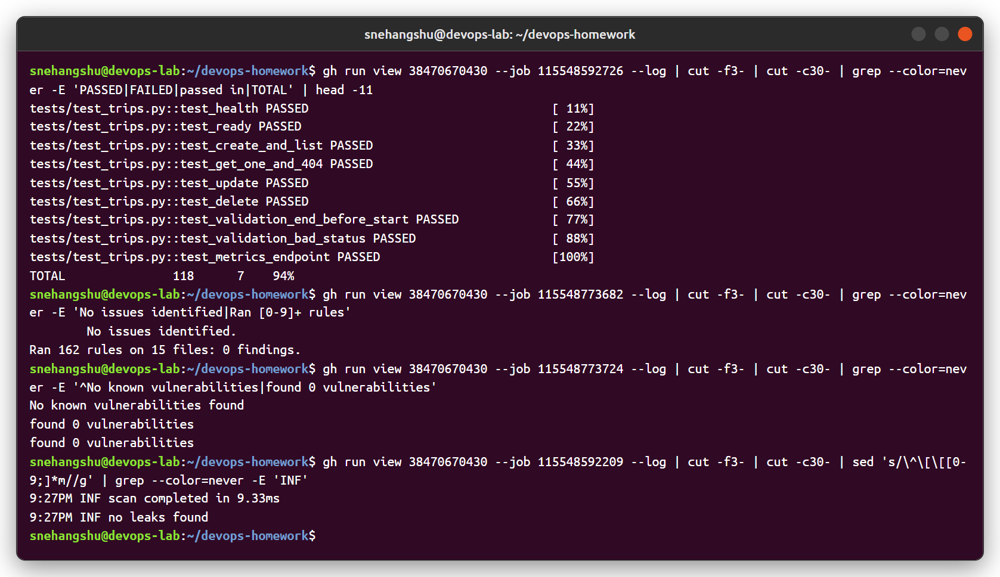
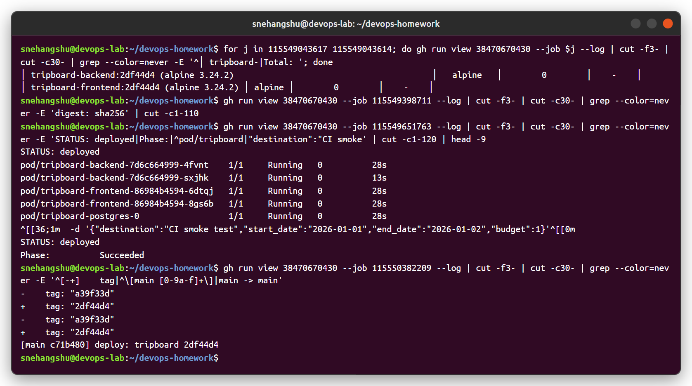
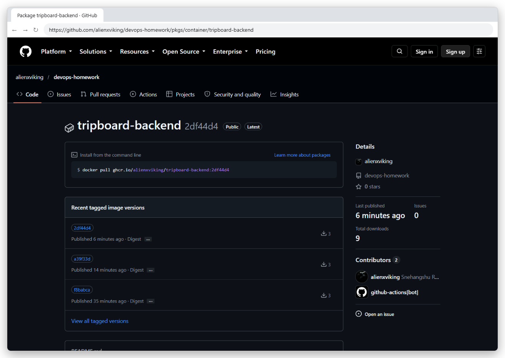

The pipeline caught real problems while I built it:
- Trivy failed the first frontend image: the `nginx-unprivileged:1.29-alpine` base had 43 fixable HIGH CVEs → moved to `1.31-alpine3.24` + `apk upgrade` → 0.
- The first deploy test timed out: `exec /entrypoint.sh: permission denied` (git on Windows had stored the script without the execute bit) and nginx exiting with `host not found in upstream`. Fixed with `COPY --chmod=0755`, `git update-index --chmod=+x` and runtime DNS resolution in nginx, and added a "debug info on failure" step to the job.

## 5. DevSecOps

| Control | Where |
|---|---|
| SAST | Bandit ([security/bandit.yaml](security/bandit.yaml)) + Semgrep in CI |
| SCA | pip-audit (backend), npm audit (frontend) in CI |
| Secret scanning | Gitleaks ([security/gitleaks.toml](security/gitleaks.toml)) in CI |
| Image scanning + gate | Trivy, `--severity HIGH,CRITICAL --ignore-unfixed --exit-code 1`, both images |
| No secrets in git | DB password generated by Terraform (`random_password`) → K8s Secret, chart uses `existingSecret` |
| Least privilege runtime | all containers non-root, `allowPrivilegeEscalation: false`, drop ALL capabilities, seccomp RuntimeDefault, read-only root FS on the backend |
| Pod Security | namespace label `pod-security.kubernetes.io/enforce: restricted` - pods that break the rules are rejected |
| Network | NetworkPolicy: only backend pods may reach Postgres on 5432 |
| Supply chain | images pinned by commit SHA, built and scanned once, the same image goes to test and prod |

## 6. Kubernetes + Helm

Chart [helm/tripboard](helm/tripboard):

| Object | Details |
|---|---|
| Deployment `tripboard-backend` | 2-5 replicas (HPA on CPU 70%), startup/liveness `/health`, readiness `/ready`, requests/limits, ConfigMap + Secret env |
| Deployment `tripboard-frontend` | 2 replicas, `/healthz` probes |
| StatefulSet `tripboard-postgres` | 1Gi PVC (volumeClaimTemplate), `pg_isready` probes, uid 70 |
| Services | ClusterIP backend:8000, frontend:8080, headless postgres |
| Ingress | host `tripboard.local`: `/api` → backend, `/` → frontend |
| ConfigMap, Secret | app config / DB credentials (`existingSecret` in prod) |
| HPA, NetworkPolicy, ServiceMonitor | autoscaling, DB isolation, Prometheus scraping |
| `helm test` | smoke test pod (ready, frontend, API through frontend) |

Production is deployed by Argo CD (section 8). To show the plain Helm workflow I also installed a **staging** copy with the Helm CLI:

```bash
kubectl create namespace tripboard-staging
kubectl label namespace tripboard-staging pod-security.kubernetes.io/enforce=restricted
helm upgrade --install tripboard-staging helm/tripboard -n tripboard-staging \
  --set environment=staging --set image.backend.tag=<sha> --set image.frontend.tag=<sha> \
  --set ingress.host=staging.tripboard.local --wait
helm test tripboard-staging -n tripboard-staging
```

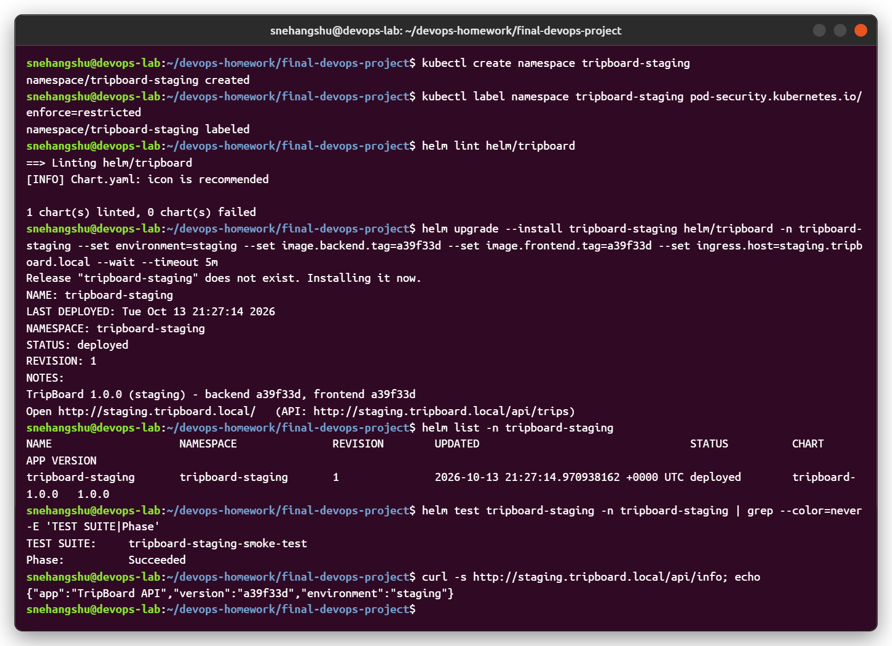

Production resources:

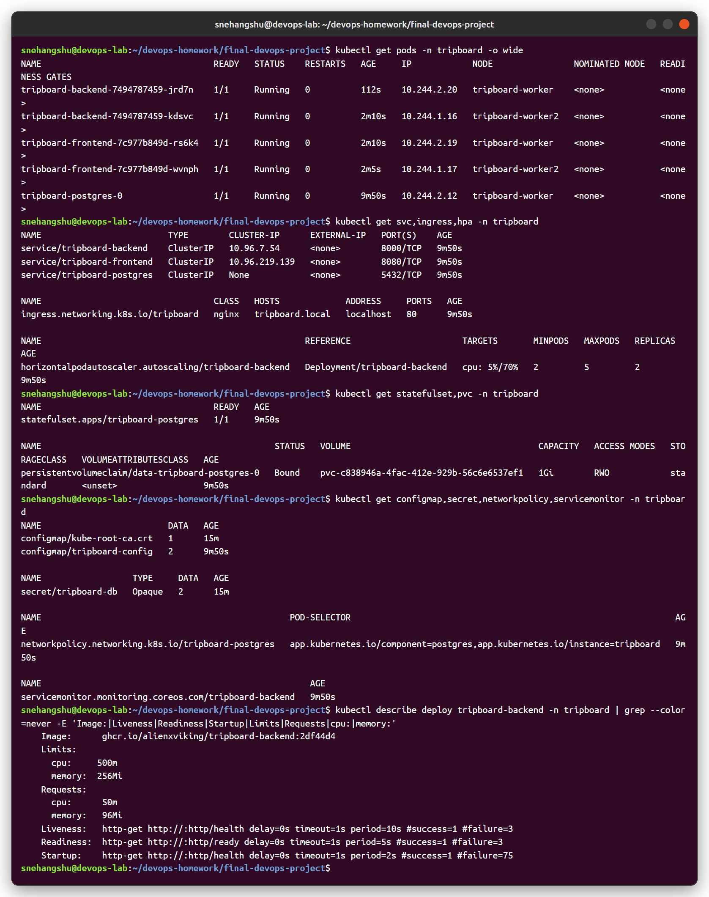

The HPA scaled the backend from 2 to 3 pods by itself under the generated traffic.

App through the Ingress:

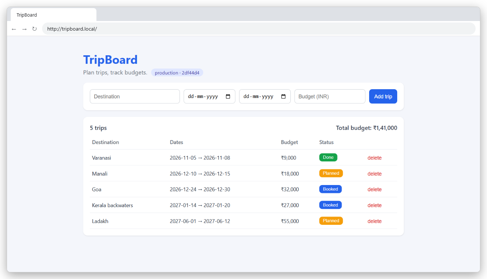

## 7. Monitoring

- kube-prometheus-stack installed by Terraform with [kube-prometheus-values.yaml](monitoring/kube-prometheus-values.yaml) (Grafana, Prometheus, Alertmanager behind the ingress).
- Backend exposes `/metrics`. The chart's **ServiceMonitor** makes Prometheus scrape every backend pod.
- Dashboard [grafana-dashboard.yaml](monitoring/grafana-dashboard.yaml) (generated by [make_dashboard.py](monitoring/make_dashboard.py)): backends up, req/s, 5xx ratio, p95 latency, trips stored, req/s per endpoint & status, latency p50/p95, CPU/memory per pod, trips by status, restarts.
- Alerts [alert-rules.yaml](monitoring/alert-rules.yaml): `TripboardBackendDown`, `TripboardHigh5xxRate`, `TripboardSlowRequests`, `TripboardPodRestarting`.

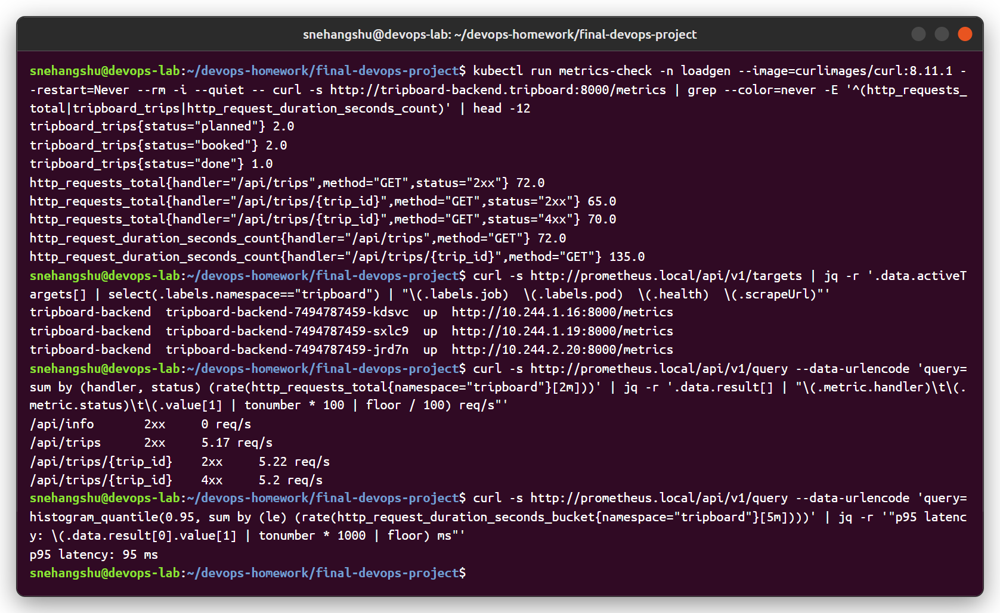
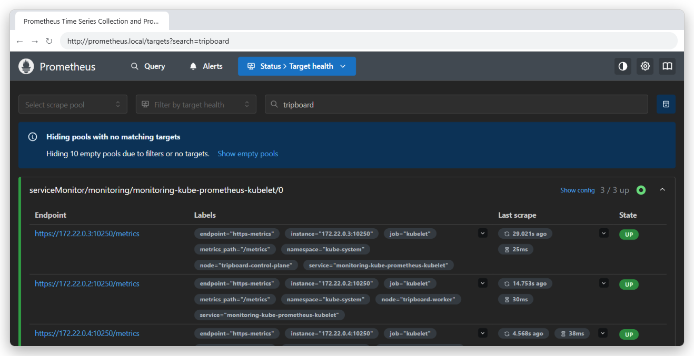
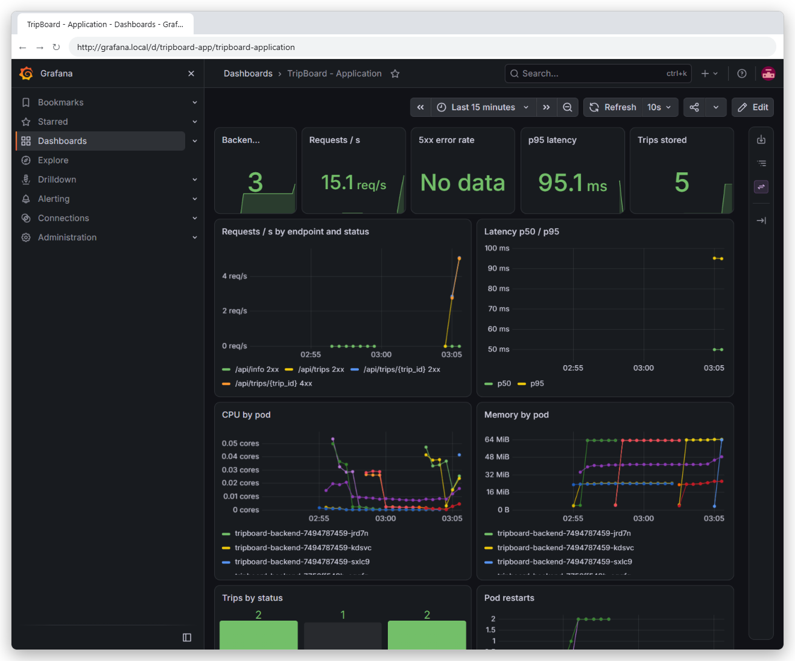


## 8. GitOps (Argo CD)

[gitops/argocd-application.yaml](gitops/argocd-application.yaml) is a **multi-source** Application: the chart from `final-devops-project/helm/tripboard` plus `$values/final-devops-project/gitops/values-prod.yaml`. It has auto-sync, `prune` and `selfHeal`. The only manual step after Terraform is applying this file once.

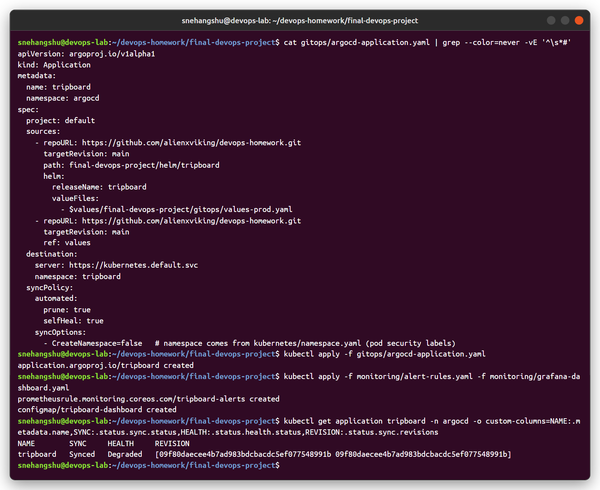

**Full flow, recorded:** I pushed a code change → the pipeline built `2df44d4`, scanned it, pushed it, and committed `deploy: tripboard 2df44d4` → Argo CD went `OutOfSync` → `Progressing` → `Healthy` → `/api/info` returned the new version. No kubectl and no manual helm.

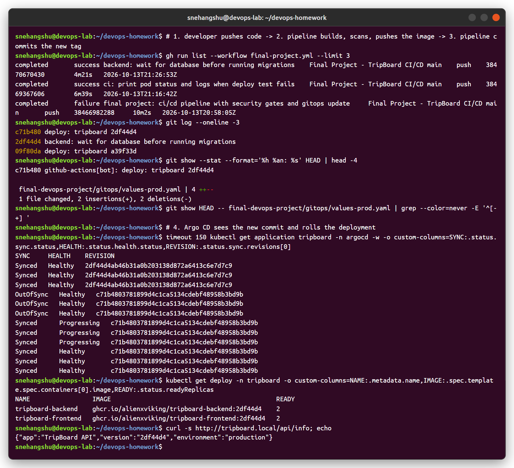
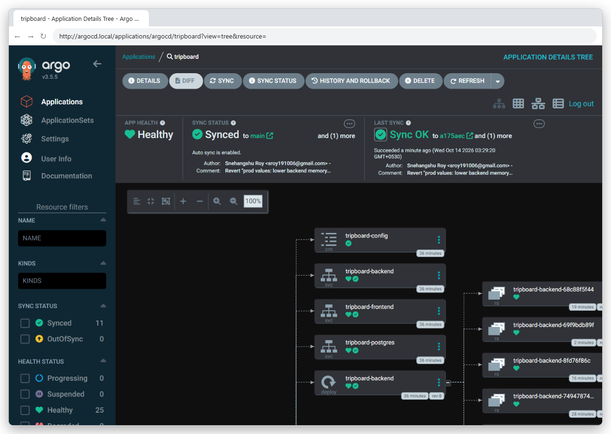


## 9. Troubleshooting challenge

→ **[troubleshooting/README.md](troubleshooting/README.md)**

| # | Fault introduced | Symptom | Root cause found with |
|---|---|---|---|
| 1 | Ingress host typo | 404 on every path | `kubectl get ingress` |
| 2 | Frontend image tag typo | `ImagePullBackOff` | `kubectl describe pod`, `docker manifest inspect` |
| 3 | DB secret renamed | Postgres `CreateContainerConfigError`, backend not Ready | events: `secret "tripboard-database" not found` |
| 4 | (side effect) StatefulSet stuck after fix | Postgres still broken after the git fix | StatefulSet revisions → delete stuck pod |
| 5 | Memory limit < request | Argo CD sync error | Argo operation message (API validation) |
| 6 | Memory limit too low | `OOMKilled`, exit 137 | `describe pod`, `kubectl top`, alert |
| 7 | Manual drift (scale to 0, delete NetworkPolicy) | none - auto-repaired | Argo CD self-heal |


## 10. Lessons learned

- Shift-left security works only if it can **fail the build**. Trivy blocked a base image with 43 HIGH CVEs that I would have shipped otherwise.
- "Works on my machine" happened to me twice: an execute bit lost by git on Windows, and nginx's startup-time DNS resolution. Building and testing the image in CI on a real cluster catches both.
- GitOps turns deployments and rollbacks into commits. Every fix in the challenge was a reviewed-looking commit or a `git revert`, and Argo CD's history matches the git history.
- Readiness probes + rolling updates contain most bad releases. A single-replica StatefulSet has no such safety net, and needs manual action after a failed rollout.
- Terraform for the whole platform (cluster, add-ons, secrets) means I can destroy and rebuild everything in about 10 minutes, which I had to do once after Docker crashed.

## Known limitations

- Runs locally: **kind instead of EKS**, **LocalStack instead of AWS** (no account). `eks.tf` is ready for real AWS but untested there.
- Single Postgres instance, no automated backups yet (the S3 bucket exists for that; a CronJob with `pg_dump` would be next).
- Grafana admin password is in the values file (lab only), and Argo CD uses its generated initial admin password.
- No TLS on the ingress (would use cert-manager in a real setup).
