# Final Troubleshooting Challenge

Faults were introduced on purpose into the running production deployment. Every fault came in the way it would in real life: as a commit to the GitOps values file, which Argo CD then applied, or as a manual change in the cluster. For each one: **identify → investigate → root cause → fix → verify**.

Starting point: everything healthy, Argo CD `Synced/Healthy`, app on version `25eb7f6`.

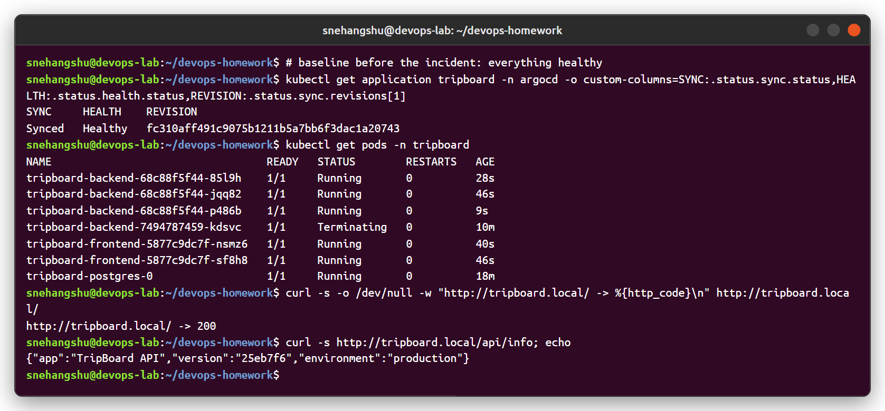

---

## Incident 1 - a "small cleanup" of the production values (3 faults at once)

Two commits were pushed straight to `main`:

- `df476e8 prod values: bump frontend, rename db secret, tidy ingress host`
- `c7323f2 prod values: bump frontend image`

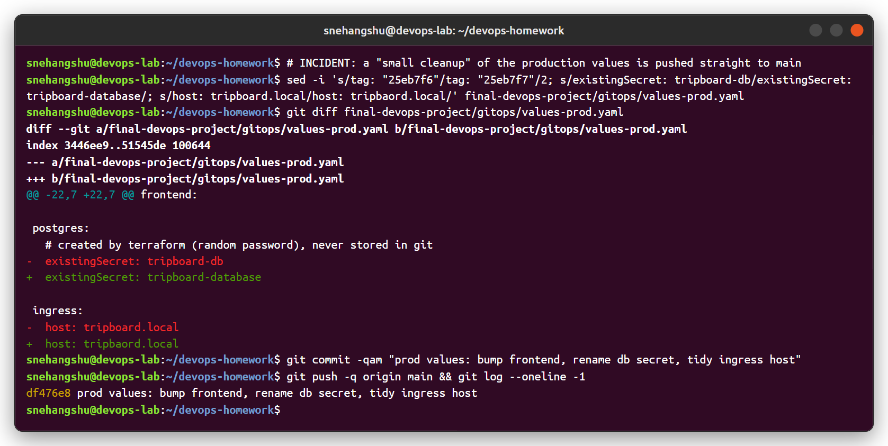
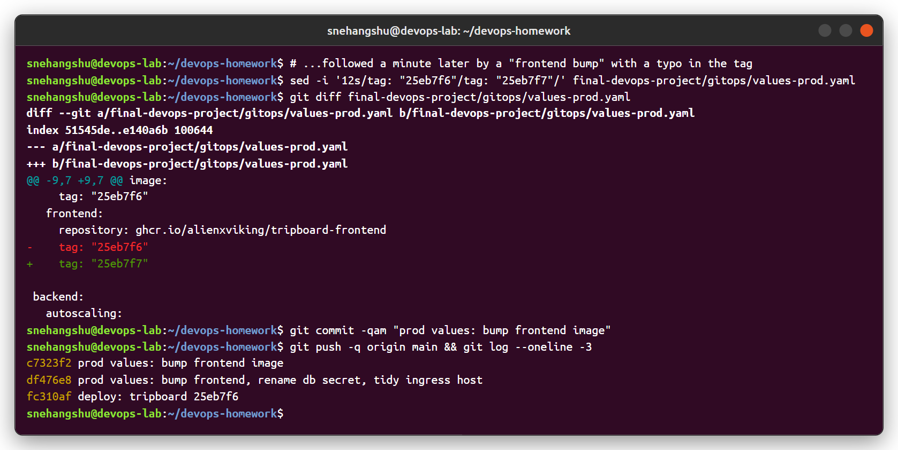

### Symptoms

`http://tripboard.local` returns **404** for every path. Argo CD says `Synced` but **`Degraded`**. Pods: one frontend in `ImagePullBackOff`, Postgres and one backend in `CreateContainerConfigError`, the other backends `0/1`.

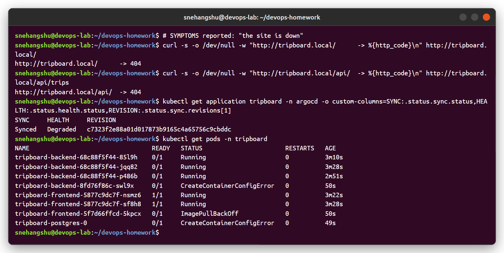
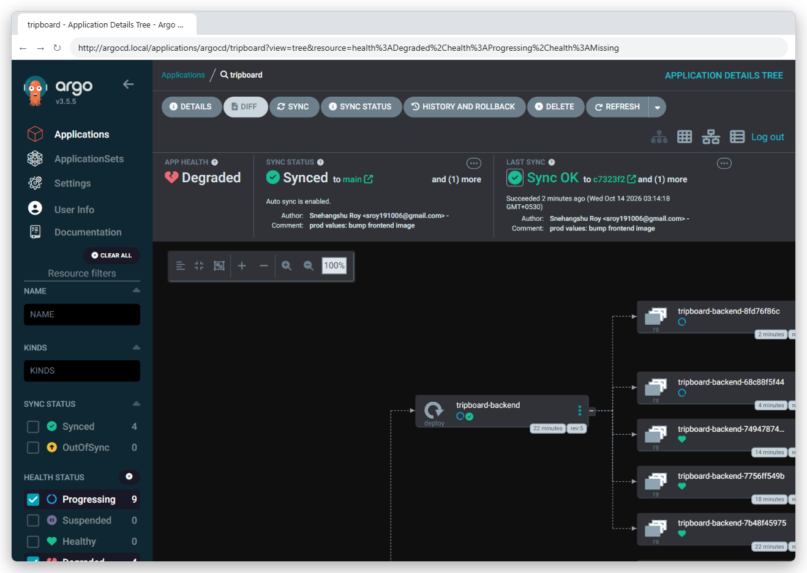

### Issue 1 - Ingress host typo

| | |
|---|---|
| Identify | 404 on every path, including `/` |
| Investigate | A 404 page from ingress-nginx means no Ingress rule matched. `kubectl get ingress` shows host **`tripbaord.local`**, and a request with `Host: tripbaord.local` works |
| Root cause | Typo in `ingress.host` in `gitops/values-prod.yaml` (found with `git log -S tripbaord`) |
| Fix | `fix(prod): ingress host typo tripbaord.local -> tripboard.local` |

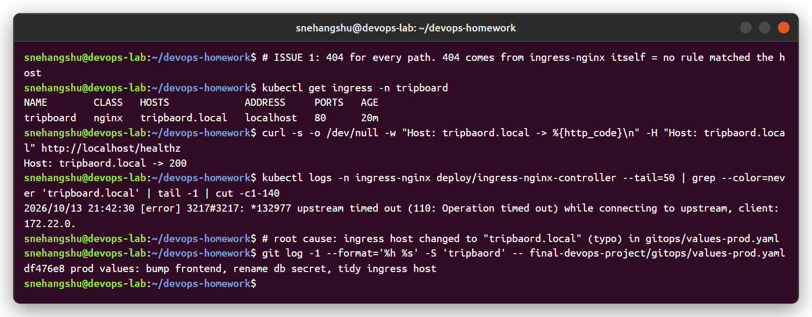

### Issue 2 - Frontend image tag does not exist

| | |
|---|---|
| Identify | New frontend pod `ImagePullBackOff` |
| Investigate | `describe pod` → `Failed to pull image ...tripboard-frontend:25eb7f7 ... not found`. `docker manifest inspect` → `25eb7f7` is unknown, `25eb7f6` exists, and the last pipeline built `25eb7f6` |
| Root cause | Hand-edited tag with a typo (the pipeline normally writes this value) |
| Impact | Small - the rolling update keeps the 2 old frontend pods running until the new one is Ready |
| Fix | `fix(prod): frontend tag 25eb7f7 does not exist, use built tag 25eb7f6` |

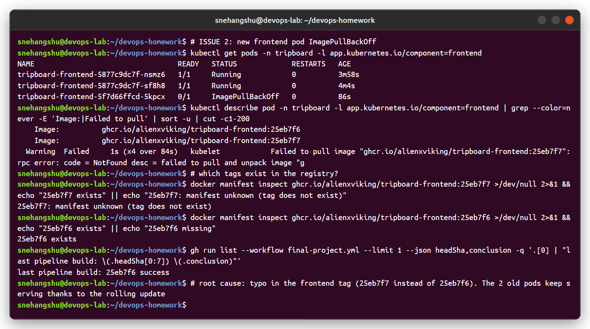

### Issue 3 - Database secret renamed

| | |
|---|---|
| Identify | `tripboard-postgres-0` and the new backend pod in `CreateContainerConfigError`. The old backend pods are running but not Ready |
| Investigate | Events: `secret "tripboard-database" not found`. `kubectl get secrets` shows only **`tripboard-db`** (created by Terraform). Postgres was restarted with the bad template, so the database is down → backend `/ready` fails → backend endpoints `ready=false` |
| Root cause | `postgres.existingSecret` changed to a secret that does not exist |
| Fix | `fix(prod): db secret is tripboard-db (managed by terraform)` |

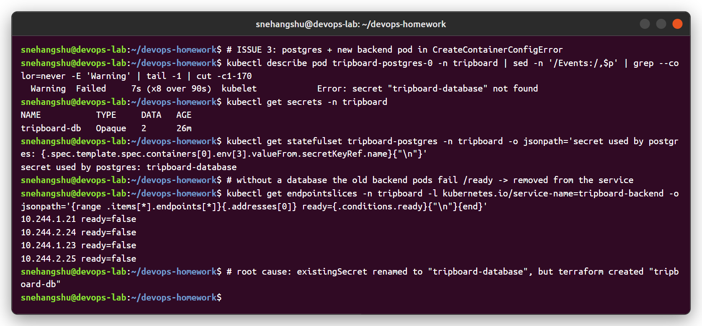

### Fix - one commit per root cause

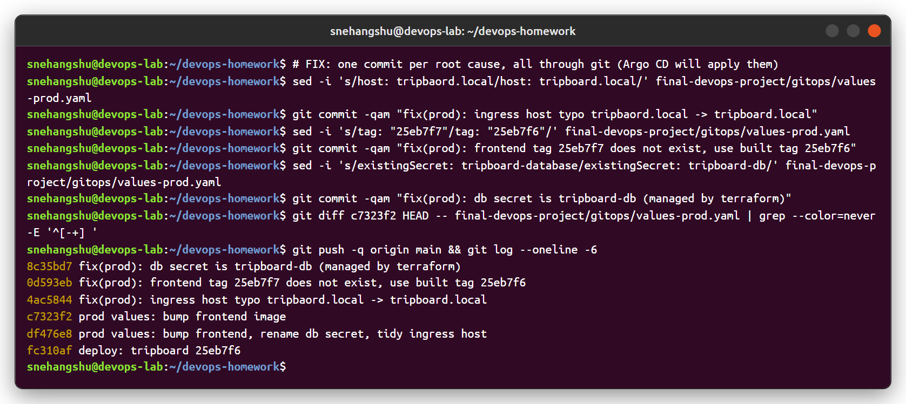

### Issue 4 - found while verifying: StatefulSet stuck

After Argo CD synced the fixes, the Ingress and frontend were back, but **`tripboard-postgres-0` was still in `CreateContainerConfigError`**:

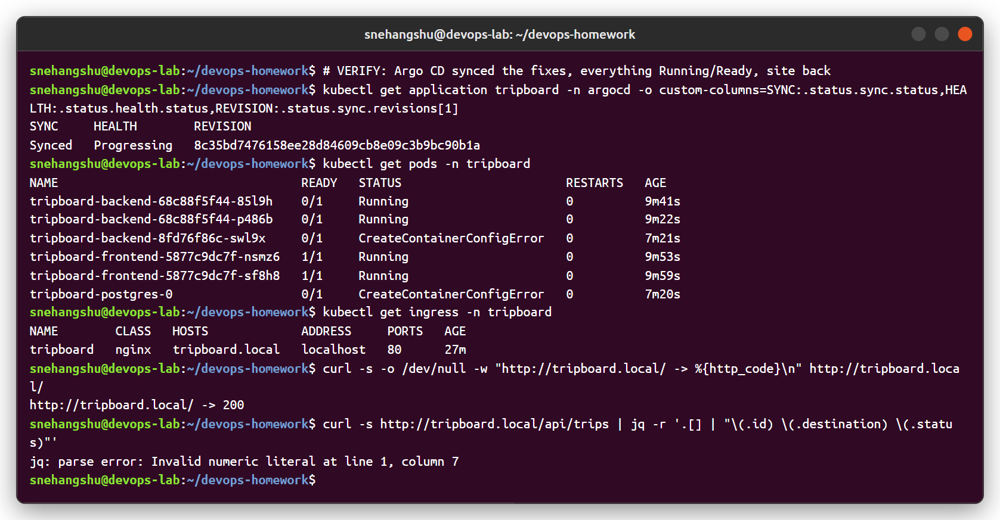

| | |
|---|---|
| Investigate | StatefulSet `updateRevision` is the fixed template, but the pod still has the old `controller-revision-hash` and still references `tripboard-database` |
| Root cause | Known StatefulSet behaviour ("forced rollback"): if a rolling update creates a pod that never becomes Running and Ready, the controller waits forever, **even after the template is fixed** |
| Fix | Delete the broken pod so the StatefulSet recreates it from the current template: `kubectl delete pod tripboard-postgres-0` |
| Verify | Postgres Ready → backend rollout completes → Argo CD `Synced/Healthy` |

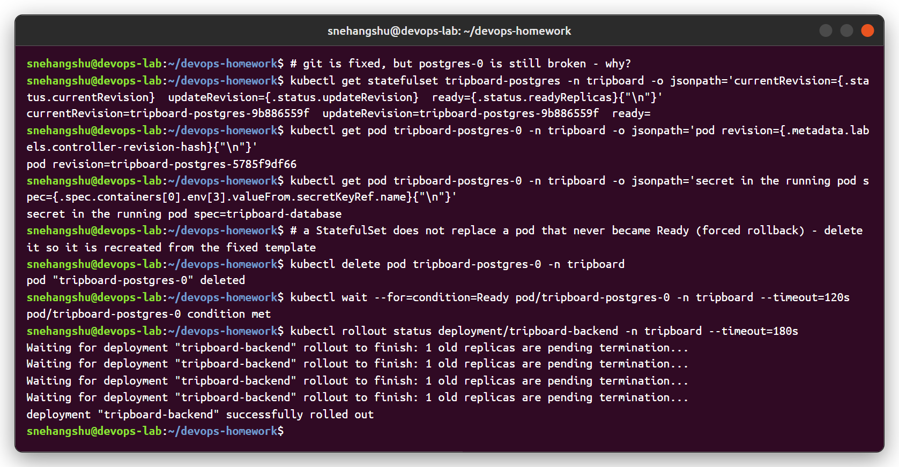

### Verified

All pods `1/1`, site 200, **all 5 trips still there** (they live on the PVC, not in the pod).

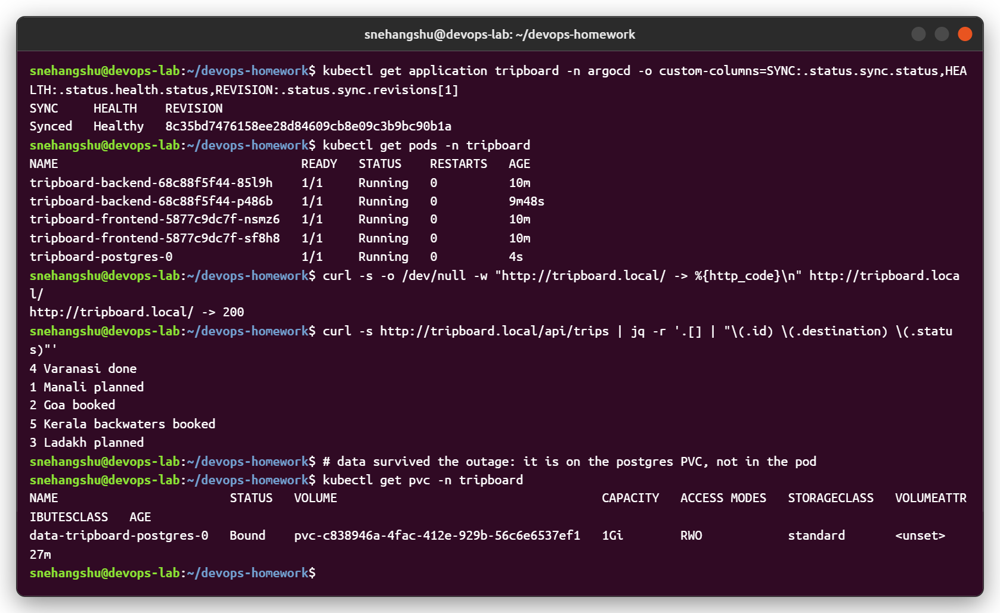

---

## Incident 2 - "saving resources" in production

The backend uses ~68Mi. Someone pushed `backend.resources.limits.memory: 48Mi`.

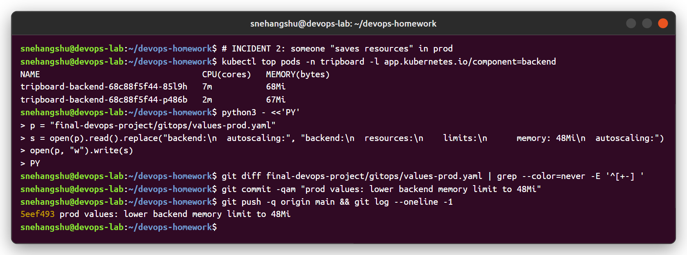

### Issue 5 - Argo CD sync fails

| | |
|---|---|
| Identify | Argo CD `OutOfSync` and retrying, app still Healthy on the old version |
| Investigate | Operation message: `Deployment "tripboard-backend" is invalid: resources.requests: Invalid value: "96Mi": must be less than or equal to memory limit of 48Mi` |
| Root cause | The new limit (48Mi) is lower than the chart's memory request (96Mi), so the API server rejects the object |
| Note | Nothing broke for users - validation stopped the bad change |

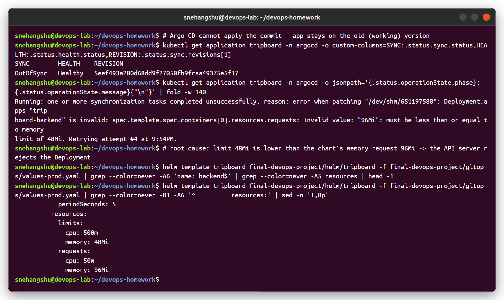

### Issue 6 - OOMKilled

The "quick fix" was to lower the request to 32Mi as well, which made the object valid:

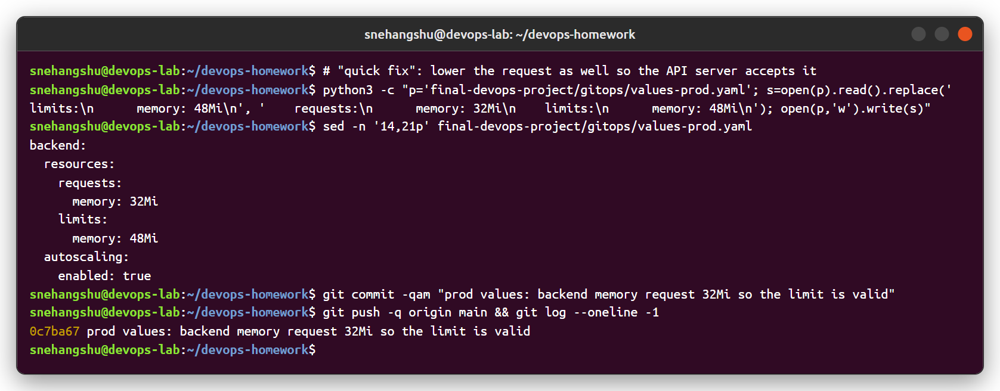

| | |
|---|---|
| Identify | New backend pod `CrashLoopBackOff`, rollout never finishes |
| Investigate | `describe pod` → `Last State: Terminated, Reason: OOMKilled, Exit Code: 137`, `Limits: memory 48Mi`. `kubectl top` shows the healthy pods use **64-68Mi** |
| Root cause | Memory limit below what Python + uvicorn + SQLAlchemy needs → kernel OOM killer |
| Alerting | Prometheus alert `TripboardPodRestarting` fired |
| Fix | `git revert` both commits (git history = deployment history) |
| Verify | Back to `requests 96Mi / limits 256Mi`, all pods `1/1`, site 200 |

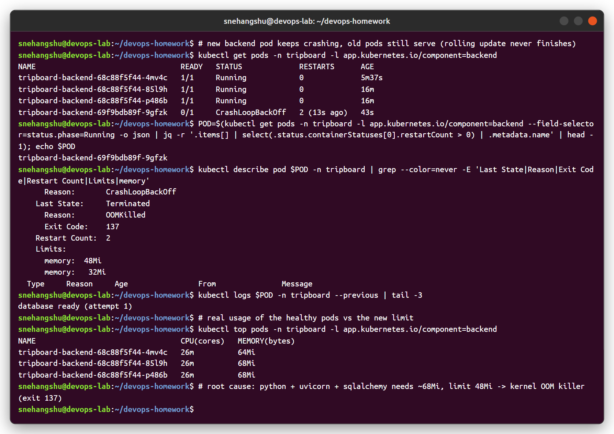
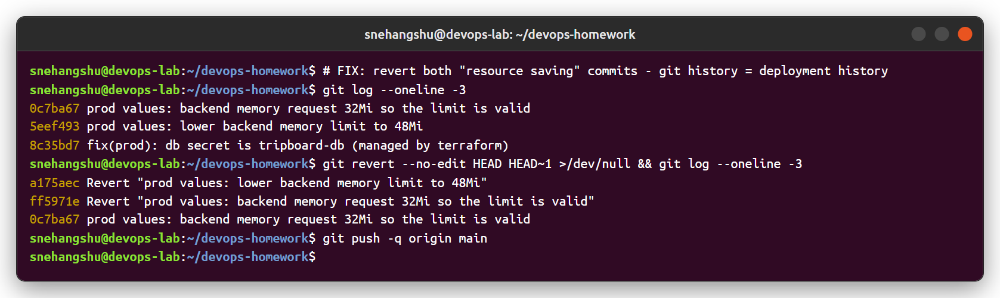
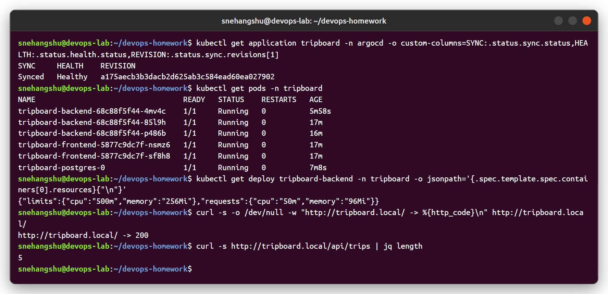
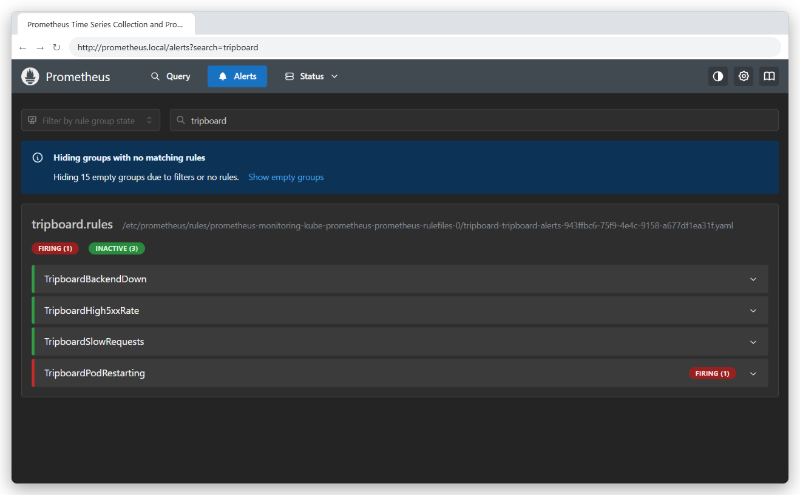

---

## Incident 3 - manual changes in the cluster (drift)

Someone scaled the frontend to 0 and deleted the Postgres NetworkPolicy with kubectl.

| | |
|---|---|
| Investigate | Argo CD compares live state with git every few seconds (`selfHeal: true`) |
| Result | Frontend back to 2 replicas and the NetworkPolicy recreated within seconds, with no human action. The site never went down |

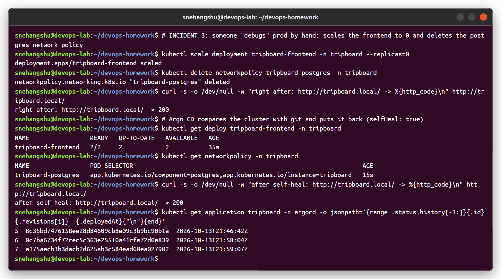

---

## What the incidents look like in monitoring

Request rate drops to 0 during incident 1, 5xx/4xx series appear, pod restarts during incident 2:

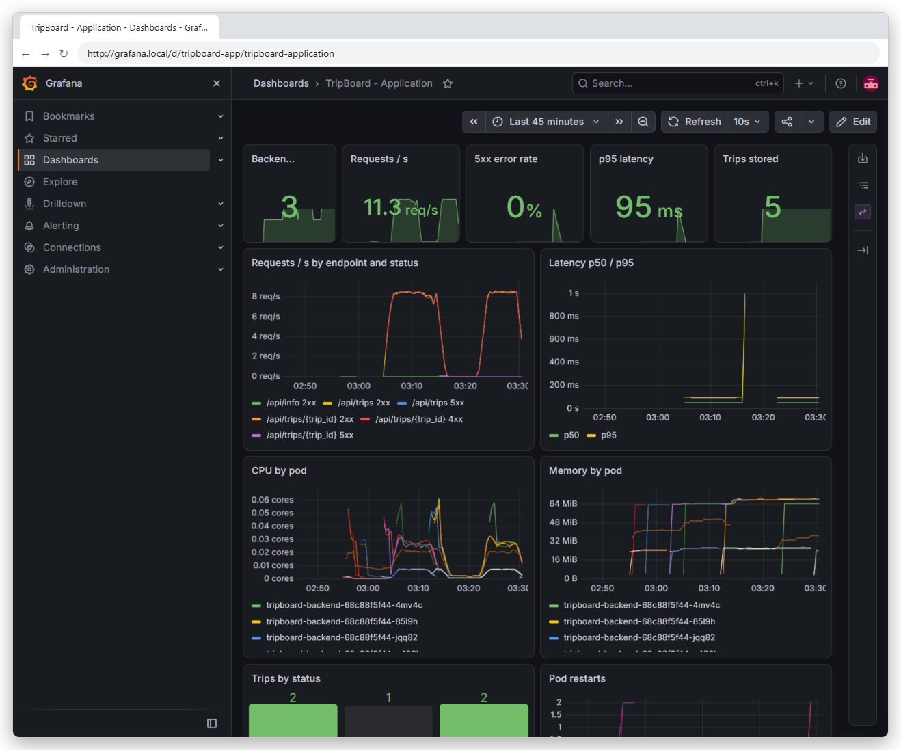

Argo CD history - every deployment and every fix is a git commit:

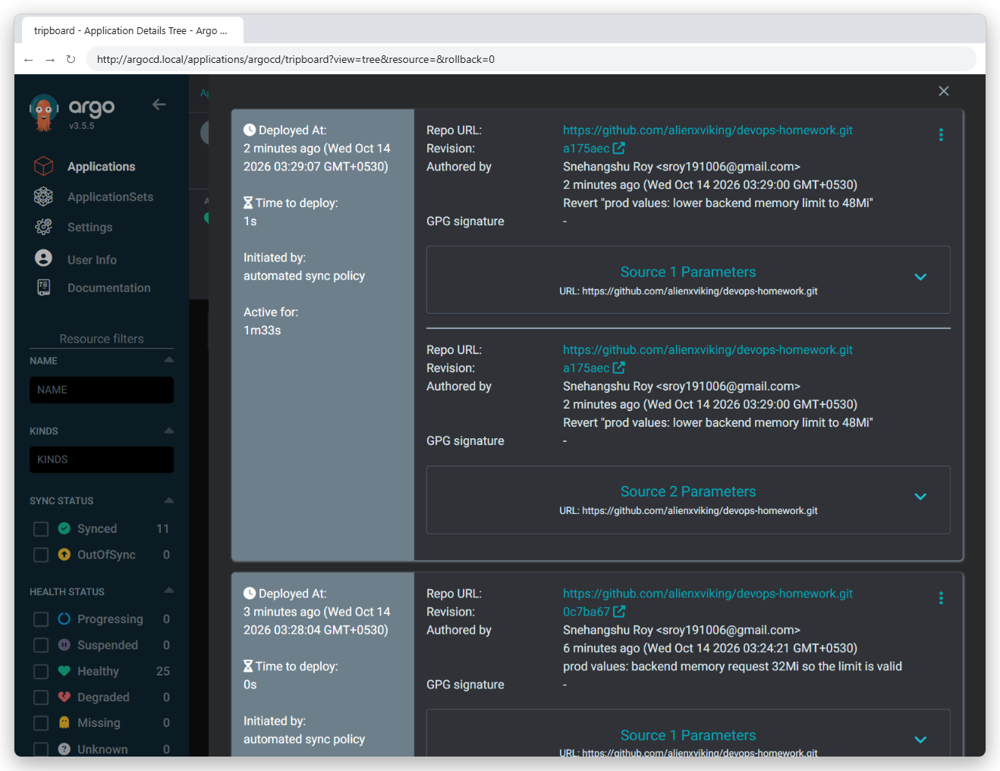

## Lessons

1. **Read the events first** - `kubectl describe` / `kubectl events` gave the root cause for 5 of the 6 issues in one line.
2. **404 from the ingress controller = routing**, 502/503 = backend/endpoints, `0/1 Ready` = probes, `CreateContainerConfigError` = missing ConfigMap/Secret, `ImagePullBackOff` = image name/tag/registry, exit 137 = OOM.
3. **GitOps makes the fix a commit** - the same review/revert workflow as code, and the cluster follows git automatically.
4. **Rolling updates limit the blast radius** - the frontend tag typo and the OOM never took the app down, because old pods stay until new pods are Ready. The secret problem did take it down, because Postgres is a single-replica StatefulSet.
5. **StatefulSets need a manual step** after a bad rollout (delete the stuck pod).
6. **Guardrails**: the image tag should only be written by the pipeline, prod values should need a PR review, and `helm template` + `kubeconform` in CI would have caught the invalid resources before merge.
